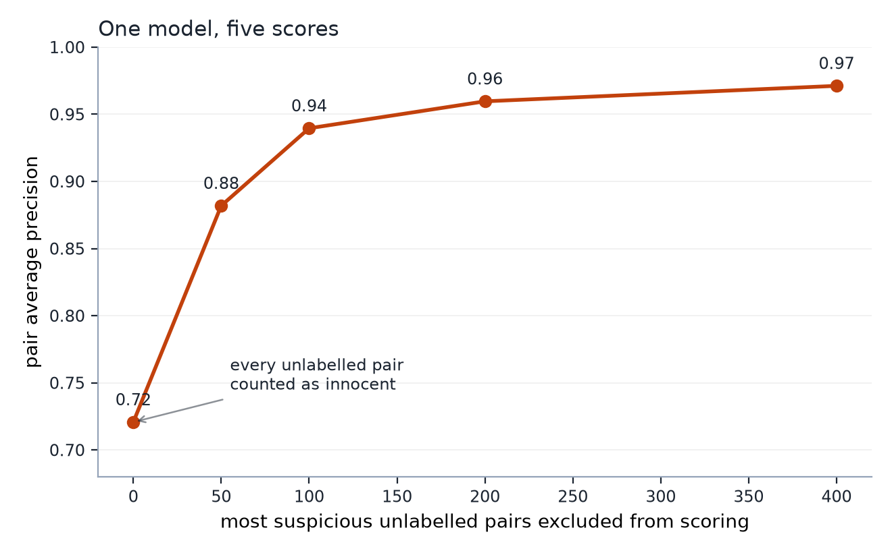

# Detecting collusion in online poker

Of 137,739 pairs of players in the development data, 1,860 carry a label and 372 of those are colluding. The other 135,879 are unknown, and an unknown share of them is colluding too. Everything in this project follows from that: the labels are partial, so the choice of metric decides what the model appears to know.

The task is to find pairs of players who secretly transfer chips to each other, across 2,000,000 hands, 18,609,028 individual actions and 12,000 players. For every candidate pair the pipeline produces three things:

| Output | Weight in my composite score | What it answers |
|---|---|---|
| Risk score | 70% | How likely is this pair colluding? |
| Evidence | 20% | Which five hands show it? |
| Behaviour | 10% | Which of three patterns: directed transfer, soft play, coordinated isolation? |

The composite is `0.70 * pair AP + 0.20 * evidence MAP@5 + 0.10 * behaviour macro-AP`, implemented in `src/metrics.py`.

`Python` · `CatBoost` · `Polars` · `scikit-learn` · positive-unlabelled weighting · learning-to-rank (YetiRank) · grouped cross-validation

## The problem

Colluding players do not cheat in ways a rule can catch. They fold winning hands to each other, decline to raise when they could, and squeeze a third player between them. Any single hand looks like an ordinary mistake. Only the pattern across hundreds of shared hands separates a cheat from a bad player.

## How it works

```
raw hands ─▶ pair-hand features ─▶ pair aggregates ─┬─▶ risk model      (70%)
             (identity-free,                        ├─▶ evidence ranker (20%)
              permutation-symmetric)                └─▶ behaviour model (10%)
```

**The features cannot learn who the players are.** Every pair-hand feature is symmetric under swapping the two players and unchanged by renaming them, and unit tests enforce that. There are four families:

- **Value transfer:** who ends up with the chips, and whether the flow followed hand strength.
- **Entry policy:** each player's own baseline looseness, so a weak hand is scored against that player's norm and not a global one.
- **Hindsight** (training only): folded players' hole cards show whether a fold surrendered a winning hand, and who was the victim of an isolation squeeze.
- **Action-local context:** whether the yield came immediately after the partner acted, and whether roles stay fixed across hands or alternate.

**Models.** Gradient-boosted trees throughout. Risk is a classifier trained with positive-unlabelled weights (8 for confirmed positives, 1 for confirmed negatives, and a small weight for unlabelled pairs: 0.04 in `src/model.py`, 0.15 in my later final configuration, which is not in this repo). Evidence is a `CatBoostRanker` with YetiRank loss, grouped by pair, blended per behaviour family in rank space. A generic risk model is blended with three per-family specialists.

**Leakage control.** Folds are `SHA256(table_id) % 5`, so players who share a table never straddle a fold boundary. Fold 0 is a lockbox, untouched until the configuration was frozen. One assembly path (`src/pipeline.py`) serves training and inference, so the two cannot drift apart.

## Results



The same model scores 0.72 pair AP if every unlabelled pair is counted as innocent, and 0.88, 0.94, 0.96 and 0.97 as I exclude the 50, 100, 200 and 400 most suspicious unlabelled pairs from scoring (`reports/risk_blend_review.json`). The true value sits inside that range. The labels alone cannot say where.

On the labelled pairs only, grouped cross-validation over folds 1 to 4 gives pair AP 0.989 to 0.997, behaviour macro-AP 0.98 and evidence MAP@5 0.42 to 0.50 per fold (`reports/validation.json`). Treat the pair AP there with suspicion: labelled pairs are the easy ones.

Evidence is the weak output. `coordinated_isolation` evidence stuck at MAP 0.27 against 0.58 and 0.63 for the other two families. I have a diagnosis and no fix.

## Two findings

### 1. The obvious validation metric measured the wrong problem

Scoring the natural way, with every unlabelled pair counted as innocent, gives 0.72. That number is low for a structural reason, not a noisy one. Only 1.3% of development pairs are labelled, so a model that correctly flags an undisclosed colluder is penalised for it. The honest report is a range, which is why the figure above shows five points and not one.

### 2. Collusion does not persist across the phase boundary

99.94% of the pairs in the later scoring phase also played together in the training window, a median of 99 hands each. That looks like free extra data. A pair's behaviour in one phase predicts its label in the other at AP 0.198 against a base rate of 0.200, which is indistinguishable from noise. Testing the attractive hypothesis first cost an afternoon and avoided a feature set that would have diluted the real signal.

## What did not work

- Relabelling suspicious unlabelled pairs as likely positives (spy-style PU relabelling): 0.712 to 0.692.
- Seed-averaging the evidence rankers: 0.5171 to 0.5112, actively harmful.
- Graded relevance for evidence hands: 0.500 to 0.477.
- Pooling behaviour families for isolation: 0.22 against 0.28 for a dedicated model.

## Layout

```
src/
  prepare.py            partition raw hands, assign folds by hash of table_id
  features.py           identity-free, permutation-symmetric pair-hand features
  population.py         label-free entry-policy baselines and contrasts
  hindsight.py          what the cards actually were: folded winners, isolation victims
  context_features.py   action-local context: immediate yielding, role consistency
  pipeline.py           single assembly path for train and inference
  build_cache.py        cache the assembled tables
  model.py              risk classifier, evidence ranker, behaviour model, evaluation
  metrics.py            pair AP, evidence MAP@5, behaviour macro-AP, composite
  make_figure.py        rebuild the figure above from reports/
tests/                  metric definitions and feature-invariance tests
reports/                validation and censoring-sensitivity numbers
```

## Running it

The hand data is not included and cannot be redistributed. The scripts expect these files in `data/`: `hands.parquet`, `seats.parquet`, `development_labels.csv`, `development_evidence.csv` and `evaluation_pairs.csv`.

```bash
pip install -r requirements.txt
python -m unittest discover -s tests    # 7 tests, no data required

python src/prepare.py      # partition, folds
python src/features.py     # pair-hand features
python src/population.py   # entry-policy features
python src/build_cache.py  # cache the assembled tables
python src/model.py        # cross-validate; add --final or --lockbox for the other runs
python src/make_figure.py  # rebuild assets/results.png
```

Everything ran on an 8GB laptop. Nothing needs a GPU or paid compute.

## Notes

Written with AI assistance (Claude and GPT). The experiment design, the negative results and the two findings above are documented in enough detail to check rather than take on trust.

MIT licensed.
